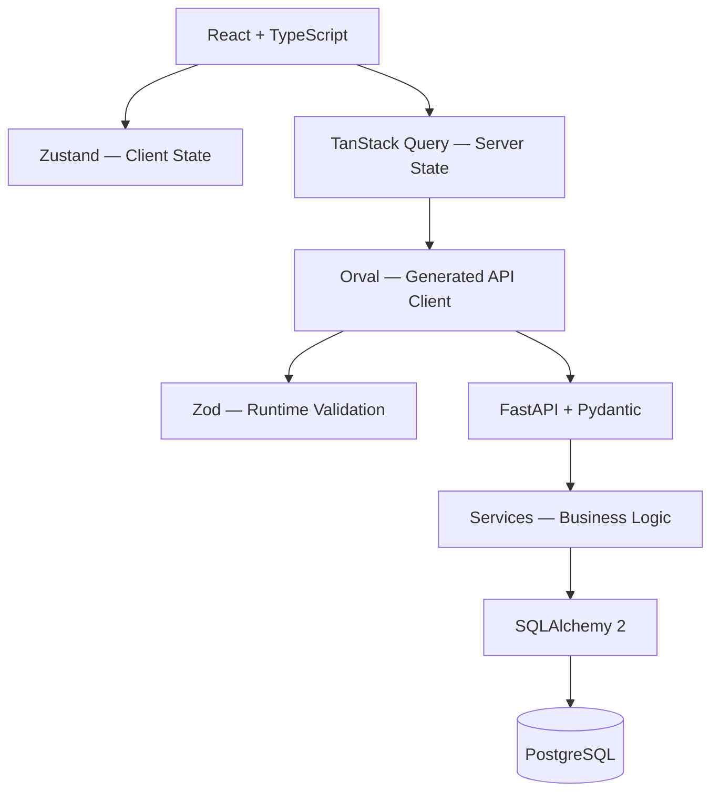

# PC Builder & Store

**Full-stack интернет-магазин компьютерных комплектующих с интерактивным 2D-конфигуратором ПК.**

Портфолио-проект, объединяющий полноценный веб-интерфейс магазина, REST API, серверную проверку совместимости комплектующих, систему пользовательских аккаунтов и демонстрационный процесс оформления заказов.

Frontend построен на **React и TypeScript**, backend — на **FastAPI и PostgreSQL**. Для взаимодействия между ними используется API-клиент, автоматически генерируемый из OpenAPI-спецификации.

> **Статус:** активная разработка. Основные пользовательские сценарии реализованы, проект продолжает проходить тестирование и доработку.
>
> **Важно:** покупки являются демонстрационными. Реальные платежи, доставка и обработка денежных транзакций не предусмотрены.

## Возможности

### Каталог товаров

- Каталог комплектующих, периферии и готовых конфигураций ПК.
- Серверный поиск с подсказками.
- Фильтрация по категориям, типам, производителям и характеристикам.
- Зависимые фильтры с учётом выбранных категорий.
- Сортировка по цене, рейтингу и дате добавления.
- Пагинация и синхронизация параметров каталога с URL.
- Карточки товаров с изображениями, ценами, рейтингами и наличием.
- Подробные страницы товаров с галереей, описанием, техническими характеристиками и отзывами.

### 2D-конфигуратор ПК

Интерактивный конфигуратор позволяет пользователю собрать собственный компьютер из восьми категорий комплектующих:

1. Процессор (CPU).
2. Материнская плата.
3. Видеокарта (GPU).
4. Оперативная память (RAM).
5. Накопитель.
6. Блок питания (PSU).
7. Корпус.
8. Система охлаждения.

Конфигуратор поддерживает:

- Выбор, замену и удаление комплектующих.
- Динамический расчёт стоимости сборки.
- Отображение характеристик выбранных компонентов.
- Проверку совместимости на стороне backend.
- Диагностику несовместимости и недостаточности технических данных.
- Сохранение и редактирование пользовательских сборок.
- Добавление совместимых сохранённых сборок в корзину.

Проверка совместимости реализована как отдельная серверная бизнес-логика, а не исключительно как визуальная проверка на frontend.

### Корзина и заказы

- Добавление отдельных товаров и пользовательских сборок.
- Изменение количества товаров.
- Удаление позиций из корзины.
- Расчёт итоговой стоимости.
- Оформление демонстрационного заказа из корзины.
- Покупка отдельного товара через **«Купить сейчас»**.
- Сохранение истории заказов в PostgreSQL.
- Исторические снимки приобретённых товаров, цен и состава сборок.

Для операции **Buy Now** предусмотрена серверная защита от создания повторных заказов с одним идентификатором покупки.

### Пользовательские аккаунты

- Регистрация и авторизация.
- Вход по email или имени пользователя.
- Профиль пользователя.
- Изменение персональных данных и пароля.
- Удаление аккаунта.
- Приватная история заказов.
- Управление сохранёнными сборками.
- Избранные товары.
- Создание, редактирование и удаление собственных отзывов.

Создание отзыва привязано к истории покупок пользователя. Доступ к приватным данным и операциям контролируется на стороне backend.

### Интерфейс

- Адаптивный интерфейс.
- Светлая и тёмная темы.
- Тёмная цветовая схема **Obsidian Black + Ice Blue**.
- Локализация на русский и английский языки.
- Интерактивные меню, фильтры, модальные окна и галереи.
- Состояния загрузки, ошибок и пустых результатов.

## Технологический стек

### Frontend

| Технология | Назначение |
|---|---|
| React 19 | Пользовательский интерфейс |
| TypeScript | Статическая типизация |
| Vite 8 | Сборка и локальная разработка |
| Tailwind CSS 4 | Стилизация и адаптивный интерфейс |
| React Router | Клиентская маршрутизация |
| Zustand | Локальное состояние приложения |
| TanStack Query | Серверное состояние, кеширование и запросы |
| Zod 4 | Валидация данных во время выполнения |
| Orval | Генерация API-клиента и схем из OpenAPI |
| i18next / react-i18next | Локализация |
| React Icons | Иконки интерфейса |

### Backend

| Технология | Назначение |
|---|---|
| Python 3.15+ | Язык backend |
| FastAPI | REST API |
| Pydantic | Схемы данных и валидация |
| SQLAlchemy 2 | ORM и работа с транзакциями |
| PostgreSQL 18 | Реляционная база данных |
| Alembic | Миграции базы данных |
| psycopg 3 | Драйвер PostgreSQL |
| PyJWT | JWT-аутентификация |
| pwdlib + Argon2 | Безопасное хеширование паролей |
| uv | Управление Python-зависимостями |
| Docker Compose | Локальный запуск PostgreSQL |

### Тестирование и качество кода

- **Frontend:** Vitest, React Testing Library, Oxlint, TypeScript.
- **Backend:** pytest, HTTPX/TestClient, Ruff, mypy.
- **API:** OpenAPI, Swagger UI, Zod runtime validation.

## Архитектура

Проект разделён на frontend и backend с независимыми слоями ответственности.



**Frontend** отвечает за представление данных, пользовательские взаимодействия, локальное состояние и кеширование ответов API.

**Backend** отвечает за аутентификацию, авторизацию, валидацию запросов, работу с данными и бизнес-правила, включая совместимость компонентов и создание заказов.

PostgreSQL является основным хранилищем данных пользователей, товаров, сборок, корзин, заказов и отзывов.

### API-контракты

FastAPI автоматически формирует спецификацию OpenAPI на основе Pydantic-схем и маршрутов.

Orval использует эту спецификацию для генерации:

- Типизированных функций HTTP-запросов.
- React Query hooks.
- TypeScript-типов.
- Zod-схем.

Сгенерированный клиент находится в `frontend/src/api/generated/`.

Ответы API проходят runtime-валидацию через Zod в кастомном HTTP-клиенте `frontend/src/api/transport.ts`.

Генерируемые файлы не предназначены для ручного редактирования.

### Аутентификация

Система использует:

- Короткоживущие JWT access tokens.
- Refresh tokens в HttpOnly cookies.
- Ротацию refresh tokens.
- CSRF-защиту операций обновления сессии и выхода.
- Отзыв серверных сессий.
- Argon2 для хеширования паролей.
- Серверную проверку доступа к приватным ресурсам.

Access token хранится в памяти frontend-приложения, а не в localStorage.

## Структура проекта

```text
.
├── backend/
│   ├── alembic/          # Миграции PostgreSQL
│   ├── app/
│   │   ├── api/          # Маршруты FastAPI
│   │   ├── core/         # Конфигурация и безопасность
│   │   ├── db/           # Подключение и сессии БД
│   │   ├── models/       # SQLAlchemy-модели
│   │   ├── schemas/      # Pydantic-схемы
│   │   ├── services/     # Бизнес-логика
│   │   └── main.py       # Точка входа FastAPI
│   ├── tests/
│   └── pyproject.toml
├── frontend/
│   ├── src/
│   │   ├── api/          # API-клиент и интеграция
│   │   ├── components/   # UI-компоненты
│   │   ├── data/         # Адаптеры и вспомогательная логика
│   │   ├── i18n/         # Русская и английская локализация
│   │   ├── pages/        # Страницы приложения
│   │   ├── stores/       # Zustand stores
│   │   └── App.tsx
│   ├── orval.config.ts
│   └── package.json
├── docs/                 # Спецификации и дизайн-материалы
├── scripts/              # Вспомогательные скрипты
├── compose.yaml          # PostgreSQL через Docker Compose
└── README.md
```

## Локальный запуск

### Требования

- Python 3.15 или новее.
- uv.
- Node.js и npm (версии, совместимые с Vite 8).
- Docker Engine / Docker Desktop с Docker Compose.

### 1. Настройка окружения

Создайте файл `.env` в корневой директории проекта:

```dotenv
POSTGRES_DB=pc_builder
POSTGRES_USER=pc_builder
POSTGRES_PASSWORD=replace_with_a_private_password

POSTGRES_HOST=127.0.0.1
POSTGRES_PORT=55432

JWT_SECRET_KEY=replace_with_a_random_secret_of_at_least_32_characters

COOKIE_SECURE=false
COOKIE_SAMESITE=lax
```

Замените значения пароля PostgreSQL и JWT-ключа собственными секретами.

`JWT_SECRET_KEY` должен содержать не менее 32 символов. Для локальной разработки через HTTP используется `COOKIE_SECURE=false`; при развёртывании через HTTPS необходимо настроить безопасные cookie.

**Никогда не добавляйте `.env` и настоящие секреты в репозиторий.**

### 2. PostgreSQL

Из корневой директории проекта:

```bash
docker compose up -d db
```

База данных будет доступна на `127.0.0.1:55432`.

Docker Compose запускает только PostgreSQL. Frontend и backend запускаются локально отдельными процессами.

### 3. Backend

Перейдите в директорию `backend`:

```bash
cd backend
uv sync
uv run alembic upgrade head
uv run poe dev
```

После запуска:

- API: http://127.0.0.1:8000
- Swagger UI: http://127.0.0.1:8000/docs
- OpenAPI: http://127.0.0.1:8000/openapi.json
- Проверка PostgreSQL: http://127.0.0.1:8000/health/db

Миграции необходимо выполнить до обращения к API. Они создают и обновляют структуру базы данных.

### 4. Frontend

Откройте второй терминал и перейдите в директорию `frontend`:

```bash
cd frontend
npm ci
npm run dev
```

По умолчанию приложение Vite доступно по адресу:

http://localhost:5173

Vite проксирует запросы `/api` на FastAPI, работающий на `127.0.0.1:8000`.

Для полноценной проверки каталога база данных должна содержать записи товаров и связанных справочников.

## Генерация API-клиента

При изменении Pydantic-схем или HTTP-контрактов backend необходимо обновлять клиент frontend.

Сначала запустите FastAPI, затем из директории `frontend` выполните:

```bash
npm run api:generate
```

Orval получает спецификацию с `http://127.0.0.1:8000/openapi.json` и обновляет файлы в `src/api/generated/`.

**Не редактируйте автоматически сгенерированные файлы вручную.**

## Тестирование

### Backend

Из директории `backend`:

```bash
uv run poe test
uv run poe lint
uv run poe format-check
uv run poe typecheck
```

Полная последовательность проверок:

```bash
uv run poe check
```

Интеграционные тесты, изменяющие данные, требуют отдельной PostgreSQL-базы и переменной окружения `PC_BUILDER_TEST_DATABASE_URL`.

Имя тестовой базы должно начинаться с `test_` или заканчиваться на `_test`. Тестовый набор запрещает выполнять такие операции над основной базой приложения.

Без указанного подключения соответствующие интеграционные тесты пропускаются.

### Frontend

Из директории `frontend`:

```bash
npm run test:run
npm run lint
npm run build
```

Сборка включает проверку TypeScript.

## Основные маршруты

| Маршрут | Назначение |
|---|---|
| `/` | Главная страница |
| `/catalog` | Каталог товаров |
| `/products/:slug` | Страница товара |
| `/builder` | Конфигуратор ПК |
| `/cart` | Корзина |
| `/builds` | Сохранённые сборки |
| `/account` | Личный кабинет |
| `/account/orders` | История заказов |

REST API использует преимущественно префикс `/api/v1`.

Полный список эндпоинтов и актуальные схемы запросов доступны в Swagger UI.

## Ограничения проекта

PC Builder & Store является демонстрационным full-stack приложением.

В текущую область проекта **не входят**:

- Реальные онлайн-платежи и платёжные провайдеры.
- Доставка и отслеживание отправлений.
- Реальное резервирование и списание складских остатков при демо-покупке.
- Публичный маркетплейс пользовательских сборок.
- 3D-конфигуратор.
- Система сравнения товаров.

Проект предназначен для демонстрации навыков frontend- и backend-разработки, проектирования API, работы с реляционной базой данных, реализации бизнес-логики, аутентификации и интеграционного тестирования.

## Разработка

Проект находится в активной разработке. Реализованные функции и API-контракты могут изменяться по мере тестирования, исправления ошибок и развития приложения.

## Автор

**Addqd**

GitHub: https://github.com/Addqd

Repository: https://github.com/Addqd/configurable-pc-store